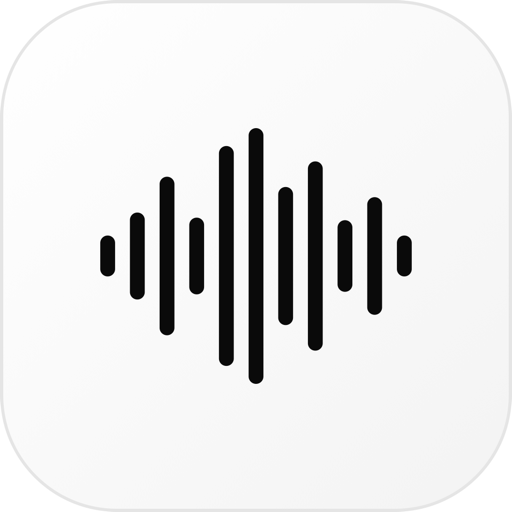

<p align="center">
  
</p>

<h1 align="center">Kokoro Studio</h1>

<p align="center">
  A clean, minimal Mac app for turning text into natural-sounding speech.<br>
  Paste text, press <b>Generate</b>, listen, and save only what you like.<br>
  100% local, powered by <a href="https://huggingface.co/hexgrad/Kokoro-82M">Kokoro-82M</a>.
</p>

---

## Concept

Most text-to-speech tools are cloud services: you paste your text into a website, wait, and pay per character. Kokoro Studio flips that around.

- **Local and private.** The 82M-parameter Kokoro model runs on your Mac. Your text never leaves your machine, and there is no account, API key or usage limit.
- **Generate, listen, then decide.** Pressing **Generate** renders the audio and plays it straight away. Nothing is written to disk until you click **Save**, so trying out voices doesn't litter your folders.
- **Fast on Apple Silicon.** Uses the GPU (Metal / MPS) by default, with a CPU fallback.
- **Designed to feel like a modern web studio.** White, quiet, black pill buttons, light and dark themes.

The logo is an abstract sound wave: a handful of rounded bars rising and falling like a voice.

## Features

- 24 voices across 6 languages: American and British English, Spanish, French, Hindi, Italian and Brazilian Portuguese
- Speed control (0.5x to 1.5x)
- Live progress bar with a **Cancel** button
- Auto-play after generating, then **Save** to WAV, MP3, FLAC or OGG (chosen by file extension)
- History of your last 20 generations, kept between launches
- Light and dark theme, remembered between launches
- `⌘ Enter` to generate

## Install

Requires macOS (Apple Silicon recommended) and either [uv](https://docs.astral.sh/uv/) or Python 3.12.

```bash
git clone https://github.com/F-O-N-S-E-C-A/Kokoro-Studio.git
cd Kokoro-Studio
./install.sh
```

The script creates a virtual environment, installs the dependencies (PyTorch is the big one, roughly 1 GB) and builds **Kokoro Studio.app** in the project folder. Open it, or drag it to your Dock or Applications folder.

The first time you generate speech the app downloads the model weights (about 330 MB). After that it works fully offline.

Prefer the terminal? After installing you can also run:

```bash
.venv/bin/python app.py
```

> Move or rename the project folder? Run `./install.sh` again so the app points at the new location.

## How to use

1. Paste or type your text.
2. Pick a voice and a speed in the right-hand panel.
3. Click **Generate speech** (or press `⌘ Enter`). It plays automatically.
4. Happy with it? Click **Save** and choose where to put it. Use a `.mp3`, `.flac` or `.ogg` extension for other formats; the default is `.wav`.

## Project layout

| File | Purpose |
| --- | --- |
| `app.py` | Python backend: Kokoro pipeline, history, settings, saving |
| `ui.html` | The whole interface (HTML, CSS, JS) shown in a native window via [pywebview](https://pywebview.flowrl.com/) |
| `make_logo.py` | Regenerates the logo files in `assets/` |
| `install.sh` | Creates the venv and builds the `.app` launcher |

## Credits

- [Kokoro-82M](https://huggingface.co/hexgrad/Kokoro-82M) by hexgrad (Apache 2.0) and the [`kokoro`](https://github.com/hexgrad/kokoro) Python package
- [pywebview](https://github.com/r0x0r/pywebview), [PyTorch](https://pytorch.org/), [soundfile](https://github.com/bastibe/python-soundfile)

## License

[MIT](LICENSE). You're free to use, modify and redistribute this project, including commercially, as long as you keep the copyright notice and credit the original author.

---

<p align="center">
  If you'd like to support my work, you can buy my app <a href="https://silverhalide.pro"><b>SilverHalide.pro</b></a>.
</p>
